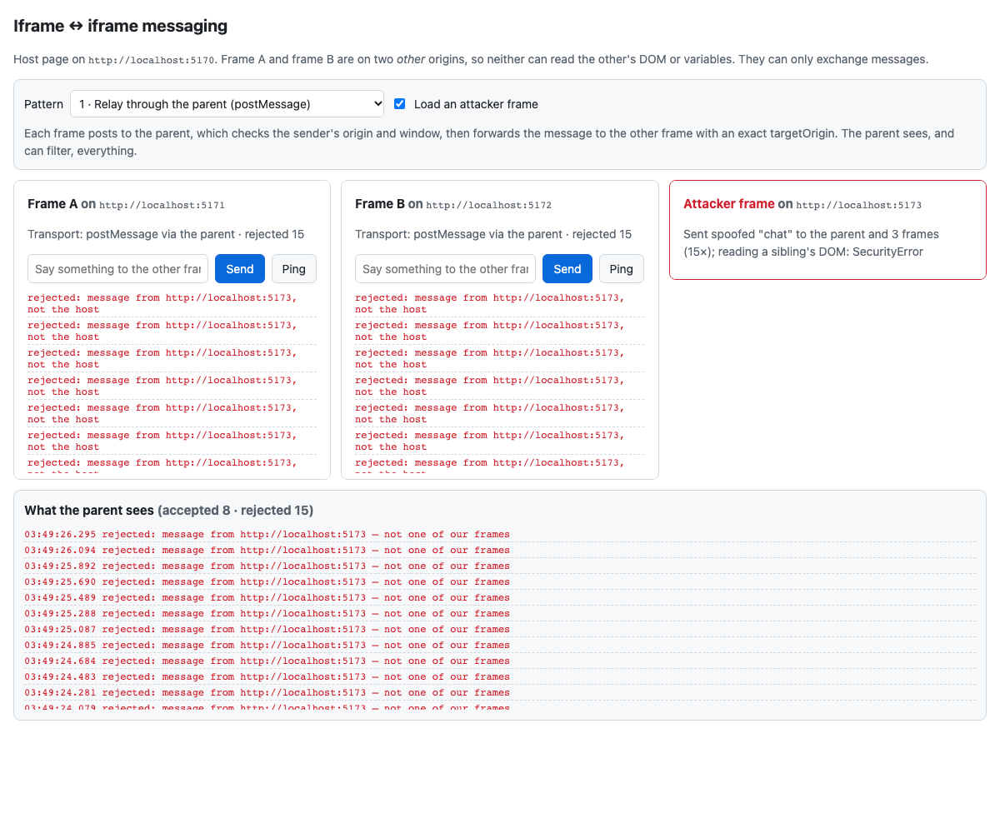

# iframe-messaging-poc

[](https://github.com/gsaini/iframe-messaging-poc/actions/workflows/ci.yml)
[](LICENSE)


A small, dependency-free proof of concept: **two iframes on two different origins talking to each other**, in three ways, with the security checks each way needs and an attacker frame that tries to break in.



## Why this is not trivial

Frame A (`localhost:5171`) and frame B (`localhost:5172`) are on different origins from each other and from the host page (`localhost:5170`). The same-origin policy means neither can read the other's DOM, variables or storage. Trying it throws `SecurityError`, as the attacker frame shows. The only way through is **message passing**, and every message channel needs an answer to "who sent this, and should I trust it?"

| Origin | Port | Serves | `Content-Security-Policy` |
|---|---|---|---|
| host | 5170 | `public/host` | `frame-ancestors 'none'` |
| A | 5171 | `public/frame` | `frame-ancestors http://localhost:5170` |
| B | 5172 | `public/frame` (same app) | `frame-ancestors http://localhost:5170` |
| attacker | 5173 | `public/evil` | `frame-ancestors http://localhost:5170` |

`server.mjs` is one Node static server per origin. Every origin also serves `/lib`, so they all share the protocol code.

## The three patterns

Pick one with the **Pattern** select on the host page. The frame app is the same in every mode; only the transport underneath it changes.

### 1 · Relay through the parent (`postMessage`)

```
A ──postMessage(msg, HOST)──▶ parent ──postMessage(msg, B_ORIGIN)──▶ B
```

- Each frame accepts messages only when `event.source === window.parent` **and** `event.origin === HOST`.
- The parent works out who sent a message by matching **both** `event.source` against each iframe's `contentWindow` **and** `event.origin` against that frame's expected origin. It then validates the envelope, checks that `msg.from` matches the actual sender, and forwards with an **exact** `targetOrigin`. If B has navigated somewhere else, the browser drops the message.
- **Use it when** the host must see, log, filter or rate-limit traffic, or when the frames shouldn't know about each other.

### 2 · Direct `MessageChannel`

```
A ──hello──▶ parent ◀──hello── B
parent: new MessageChannel()  →  port1 to A, port2 to B   (transferred, not copied)
A ◀════════ port ════════▶ B      parent no longer in the path
```

- The parent is trusted once, for the handshake. After that A and B talk port to port, and the parent never sees the traffic. The tests assert that the host log contains no chat text.
- A `MessagePort` has no `origin` to check. Trust comes from the fact that only the peer holds the other end.
- **Use it when** the frames talk a lot, the host shouldn't see the content, or you want a dedicated channel per pair.

### 3 · `BroadcastChannel` (same origin only)

- When both frames load from `:5171`, `new BroadcastChannel("iframe-poc")` connects them with no parent involvement.
- **3b, "different origins":** the same code with A on `:5171` and B on `:5172` delivers **nothing**. A ping times out after 2 s. A `BroadcastChannel` is scoped to an origin and its storage partition. It is not a cross-origin tool, and this mode is here so you can watch it fail.

## Security checks demonstrated

| Check | Where | What breaks without it |
|---|---|---|
| Exact `targetOrigin`, never `"*"` | every `postMessage` the app sends | if a frame navigates to another origin, the message leaks to that origin |
| `event.origin` **and** `event.source` | parent's `senderOf()`, frames' `viaParent` / `viaPort` | another frame on an allowed origin, or any frame at all, could impersonate a peer |
| `msg.from` must equal the real sender | parent | A could claim to be B |
| Envelope validation (`v`, `type`, `id`, `from`, payload shape, 500-char limit) | `lib/protocol.js` `invalid()` | malformed or oversized data reaches app logic |
| `CSP: frame-ancestors` | `server.mjs` | any site could embed frame A and talk to it as its parent |
| `sandbox="allow-scripts allow-same-origin"` | host iframes | — (`allow-same-origin` is safe here *because* each frame is cross-origin to the host) |

**The attacker frame** (tick "Load an attacker frame") posts a well-formed `chat` envelope claiming to be from A. It sends 15 rounds, each to the parent and to every `window.parent.frames[i]`, using `"*"`. The envelope itself is valid, so only the origin and source checks catch it. The parent and both frames reject every one, and the real chat keeps working alongside the attack.

### A lesson the tests caught

The frames started with a `<form>` around the input. Because they are sandboxed **without** `allow-forms`, Chromium and Firefox block form submission entirely and never fire `submit`, while WebKit does fire it. Chat therefore worked in Safari and silently did nothing elsewhere. The fix was a `type="button"` plus an Enter-key handler, not loosening the sandbox. Test on all three engines.

## Request/response on top of messages

`postMessage` is fire-and-forget. `lib/protocol.js` adds a small RPC layer:

- each request carries an `id`;
- the response echoes that `id`;
- an unanswered request rejects after 2 s.

The **Ping** button uses it and reports the round-trip time. In mode 3b this is how the failure becomes visible: `ping failed: no response … within 2000 ms`.

## Run it

```bash
pnpm install
pnpm start          # starts all four origins
open http://localhost:5170/
```

Requires Node 20+ and has no runtime dependencies. Playwright is only used for the tests.

## Test it

```bash
pnpm exec playwright install   # once
pnpm test                      # 9 tests × Chromium, Firefox, WebKit
```

The tests cover:

- **Relay:** both directions (button and Enter key), plus an RPC round trip.
- **Channel:** chat and ping work, and the parent forwarded and saw nothing.
- **Broadcast:** works on one origin and fails across origins.
- **Security:**
  - spoofed messages are rejected by the parent and by both frames;
  - the CSP headers are present;
  - an embed from the attacker origin is refused.

Locally the suite passed 135 of 135 runs with `--repeat-each=5`.

## Layout

```
server.mjs              four static origins + CSP headers
public/lib/             config (origins), protocol (envelope, validation, RPC), styles
public/host/            the parent page: relay, port hand-out, logs
public/frame/           the frame app, served as A and B
public/evil/            the attacker frame
tests/messaging.spec.js Playwright suite
```

## Not covered

- Origins on real domains. The pattern is the same, but use HTTPS and list exact origins: no wildcards, no `endsWith` checks.
- Structured-clone limits (functions and DOM nodes can't be sent), and transferring `ArrayBuffer`s for large payloads.
- Libraries such as Comlink or Penpal, which wrap pattern 2 in a proxy API. This repo shows what they do underneath.

## License

MIT © 2026 Gopal Saini
